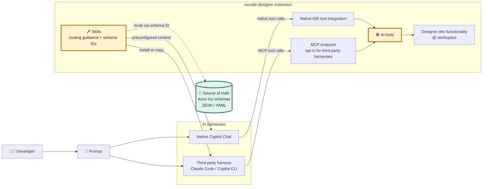

# 🧩 AI Tooling Architecture

## Overview

Axon Ivy schemas are the source of truth for project formats. Skills route the harness to relevant schemas and tools; tools provide callable Designer functionality.

Native IDE integration and the opt-in MCP endpoint are separate access paths to the same AI tools. Those tools delegate to Designer development functionality operating on the Ivy workspace.

## Harness Integration

- **Native IDE experience:** The extension comes preconfigured with tools and skills for Copilot; no separate tool installation is needed.
- **Third-party harness:** Install or copy the skills into the harness environment. To use tools, enable the extension's local MCP endpoint and configure the harness to connect to it. MCP is disabled by default.

See [AI engineering](../../ai-engineering.md), [Skills](../../skills/skills.md), and [MCP integration](../../mcp/mcp.md) for setup details.
